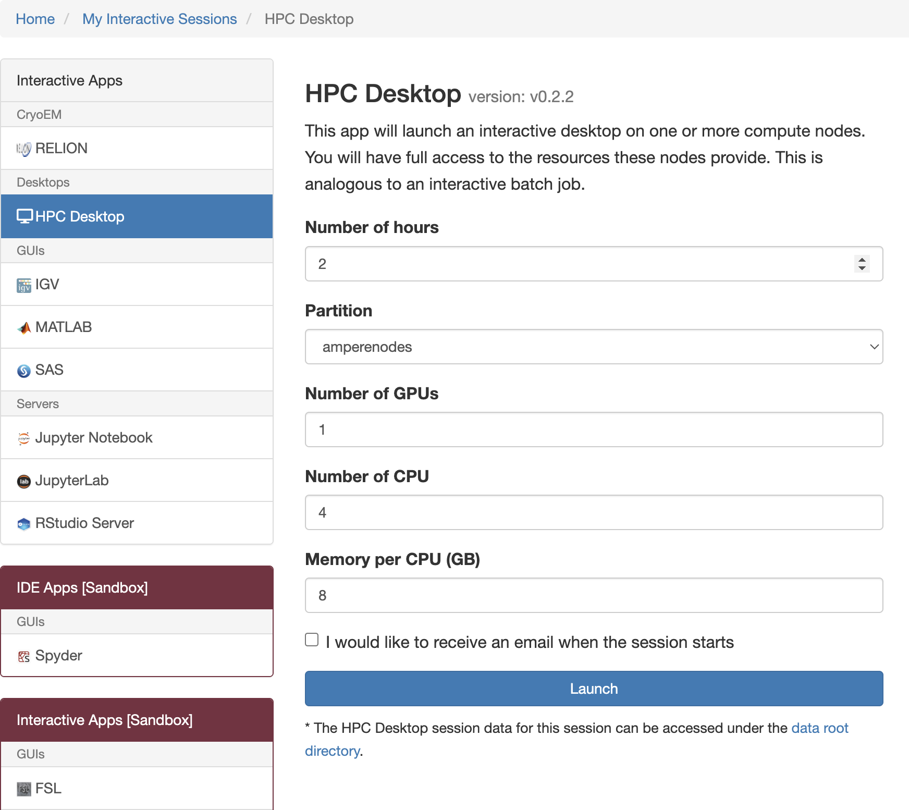
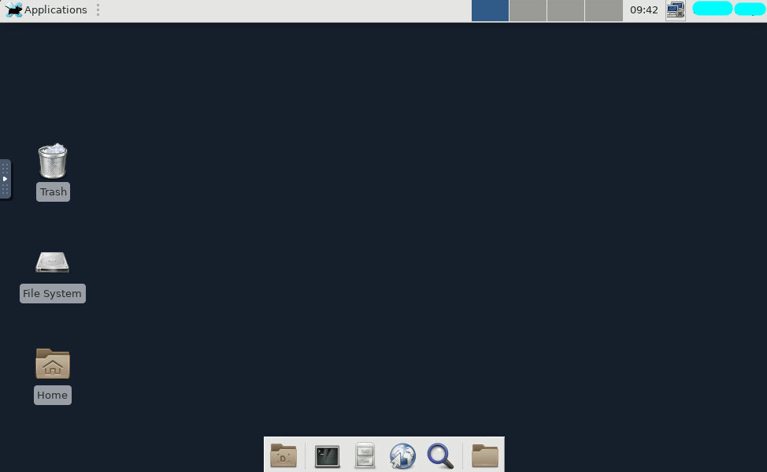
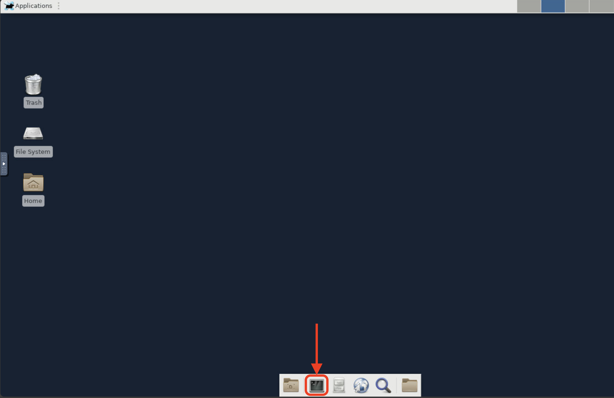
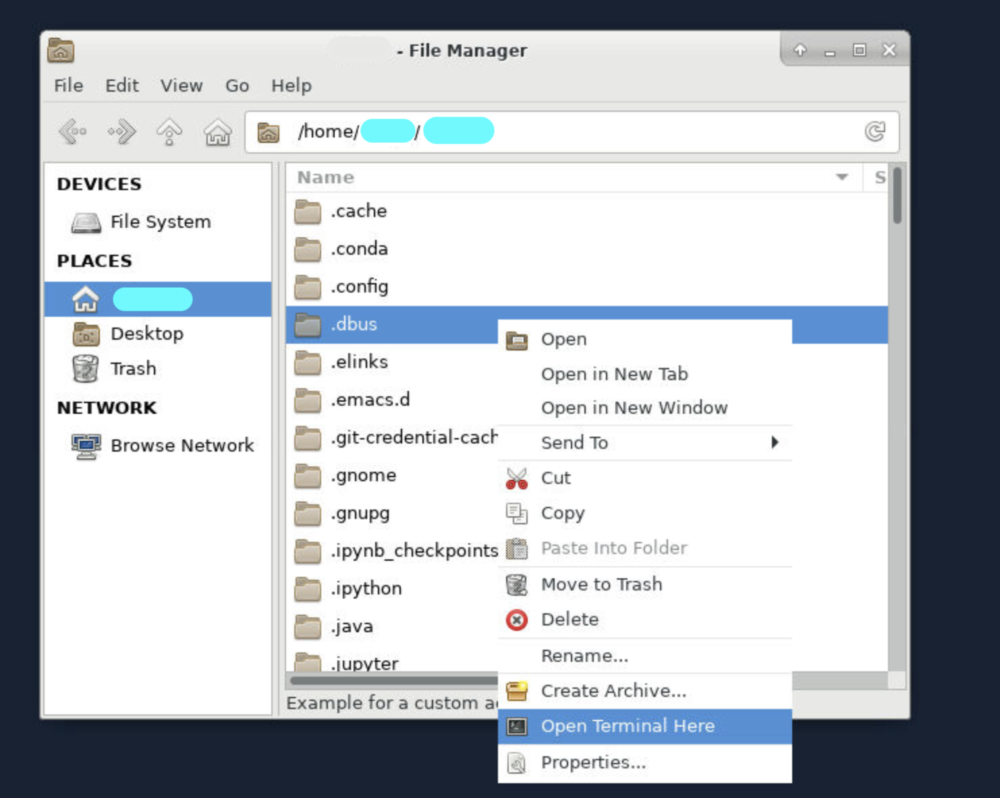
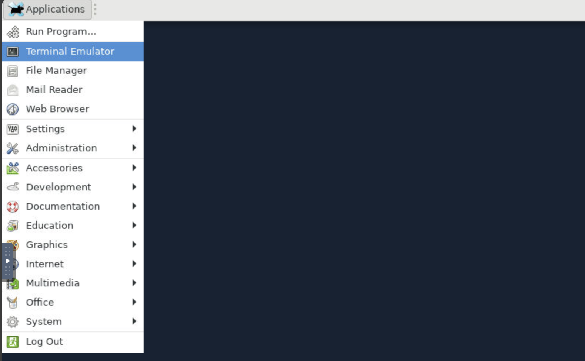
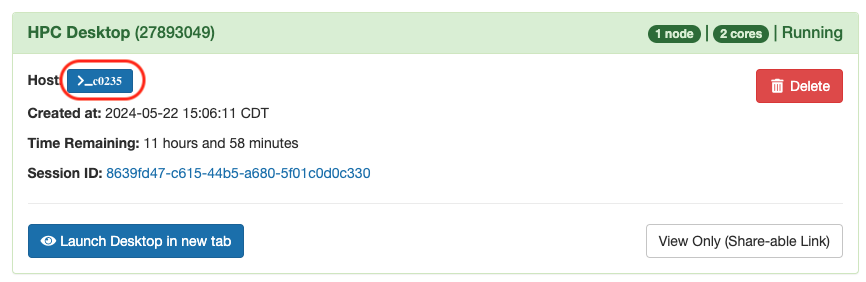
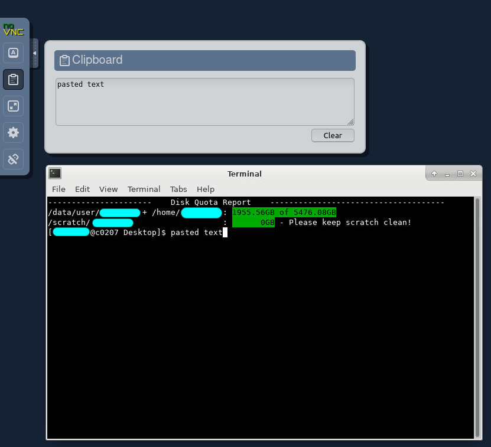
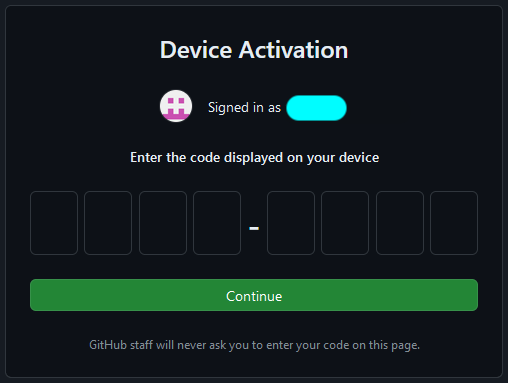

# HPC Desktop

The HPC Desktop is a general desktop interface for Cheaha. It can run all software installed on Cheaha including those with graphical interfaces which can't be run from a base terminal. To launch the HPC Desktop app, please navigate to the "Interactive Apps" menu option and select "HPC Desktop". A job creation form will appear, allowing you to configure the options you require to run your HPC Desktop session. Below the form, you will find a checkbox if you would like to receive an email notification when your session starts, as well as a blue "Launch" button to initiate the session.



It has the same functionality as a standard Centos 7 desktop including a web browser for accessing the internet. The HPC Desktop is a standard tool used for pipeline and analysis development when creating scripts to use in batch jobs. Below, you can see an example of the basic available desktop.



## Using the Terminal

The terminal (also known as the command line, unix shell or shell) allows users to interact with the system using text-based commands. The Terminal is commonly used in HPC environments like ours, for file management, module loading, job submission, and more. Common commands include navigating directories (`cd`), listing files (`ls`), moving or copying files (`mv`, `cp`), and checking your current working directory (`pwd`).

We recommend the Software Carpentries tutorial for getting familiar with terminal and shell commands. You can find details about the terminal and other recommended tutorials in our [Training Resources](../../education/training_resources.md#the-carpentries) page. Additional information is available in our documentation on the [shell](../../workflow_solutions/shell.md).

Below are examples of using appropriate commands within the terminal to;

### Navigate Directories

`cd /path/to/your/folder` - This will change the location within terminal, to the directory specified.

`ls` - This will list all files found in the directory.

`pwd` - This will return as an output the filepath of terminal's current location

### Run Commands

`module load Miniconda3` - This will load a module.

`conda activate myenv` - This will activate an already created Conda environment.

### File Management

`touch script.sh` - This will create an empty file named "script.sh".

`rm script.sh` - This will delete the referenced file.

`nano script.sh` - This will allow you to open the referenced file using a text editor called "Nano".

`vi scirpt.sh` - This will open the referenced file using another text editor called "Vim".

### Clipboard Functions to Cut, Copy, and Paste

You can also copy, cut and paste into a terminal on the HPC desktop job. To do this, please see our section [Copy-Paste Into HPC Desktop](./hpc_desktop.md#copy-paste-into-hpc-desktop).

## Accessing the Terminal

The Terminal is available within the HPC Desktop App on Cheaha, and can be accessed several ways;

1. From the HPC Desktop, you can access the terminal by clicking on its icon. This will open the shell, by default you will see an output showing your home directory.

    

1. You can also open the terminal from within a directory/folder, by right-clicking on the directory/folder, and then selecting the "Open Terminal Here" menu option. This will open the terminal in that directory.

    

1. You can also access the terminal, by clicking on the "Applications" button in the top left corner of an open HPC Desktop Interactive session. From the list of applications, select the "Terminal Emulator" option, this will also open a terminal for you to use.

    

1. Alternatively, a terminal can also be accessed from the blue "Host" button on a created interactive job. This will open a terminal in the compute node for that job to run commands as needed.

    

## Copy-Paste Into HPC Desktop

The HPC Desktop app is run through [noVNC](https://novnc.com/info.html). This setup means it is not possible to conventionally copy-paste text between the Desktop tab and other tabs or software on the host machine (i.e. a lab workstation or personal laptop). To copy-paste text, noVNC provides a control panel with a clipboard for passing text between the VNC session and the host machine. The control panel is available by clicking a tab on the far left of the screen, halfway down (see the red rectangle in the image below).


Once you click the tab, you'll see the control panel appear. The second option from the top will open a clipboard. Paste text from your local machine into the clipboard and then paste into either a terminal or another program in the VNC session. See below for an example.



To copy from the VNC to your personal machine, highlight the text you want to copy in the VNC session, and that text will appear in the clipboard. Select the text in the clipboard, copy it, and then paste it on your local machine. Images cannot be copy-pasted through this clipboard. Instead, images should be saved as a file and then transferred through tools such as [Globus](../../data_management/transfer/globus/index.md), [rclone](../../data_management/transfer/rclone.md), or an [scp utility](https://servicenow.iu.edu/kb?id=kb_article_view&sysparm_article=KB0024361).

## Visual Studio Code Remote Tunnel

It is possible to remotely access Cheaha using an HPC Desktop job as a host for Visual Studio Code (VSCode), with the "Remote - Tunnels" extension. You can read more about the extension and process at <https://code.visualstudio.com/docs/remote/tunnels>.

To use this method you will need either a GitHub account or Microsoft account. Microsoft accounts can be obtained using your SSO credentials through Microsoft.

<!-- markdownlint-disable MD046 -->
!!! warning

    Please do not use technologies like VSCode "Remote - SSH" (extension on VSCode) or Cursor Server to connect to Cheaha. These methods run all of their processes on the login node, so they are automatically terminated. Instead, use "Remote - Tunnels" as described below. See [additional information](../getting_started.md#why-you-should-avoid-running-jobs-on-login-nodes) about running jobs on the Login node.
<!-- markdownlint-enable MD046 -->

### What Security Does VSCode Remote Tunnel Use?

The VSCode Remote Tunnel extension uses the Dev Tunnels software product. The Dev Tunnels uses your GitHub or Microsoft credentials to authenticate, and data transfers through the tunnel are end-to-end encrypted. To learn more about Dev Tunnels security, please read <https://learn.microsoft.com/en-us/azure/developer/dev-tunnels/security>

<!-- markdownlint-disable MD046 -->
!!! note

    When using a tunnel, all information visible within VSCode is end-to-end encrypted and sent from Cheaha to your local machine through a third-party service (the tunnel). Use of any third party services and encryption for Restricted/PHI Data may require a risk assessment first. Please [contact us](../../help/support.md) if you need to use VSCode to work with PHI or other restricted data.
<!-- markdownlint-enable MD046 -->

### Downloading and Installing VSCode and VSCode Server

<!-- markdownlint-disable MD046 -->
!!! note

    Support for the Cheaha operating system (CentOS 7) ended with version 1.99 of VSCode, released in March, 2025. Versions 1.98.2 and earlier are still supported.

    The following instructions show how to download and install version 1.98.2. You will also need to install the same version of VSCode on your local computer. See the [VSCode documentation](https://code.visualstudio.com/updates/v1_98) for links to installers for the operating system on your local computer.

    It is important to deny any update requests for both VSCode CLI on Cheaha and your local VSCode. Connection between your local computer and Cheaha requires the same version on both ends. See [Automatically Rejecting Updates](#automatically-rejecting-updates) to learn how to automatically deny update requests.
<!-- markdownlint-enable MD046 -->

First, open a terminal on Cheaha. Run the following commands if you have used VSCode before to remove some hidden files. If you are installing VSCode for the first time, skip to the next code block.

``` bash
rm -r ${HOME}/.vscode
rm -r ${HOME}/.vscode-cli
```

Next, use the following commands to install both VSCode and VSCode Server:

``` bash
curl -L -o vscode_cli.tar.gz 'https://update.code.visualstudio.com/1.98.2/cli-alpine-x64/stable'
mkdir $HOME/bin
tar -xz -C ${HOME}/bin -f vscode_cli.tar.gz

export commit_sha='ddc367ed5c8936efe395cffeec279b04ffd7db78'
curl -L "https://update.code.visualstudio.com/commit:${commit_sha}/server-linux-x64/stable" -o vscode_server.tar.gz
mkdir -vp ~/.vscode-server/bin/${commit_sha}
tar --no-same-owner -xzv --strip-components=1 -C ${HOME}/.vscode-server/bin/"${commit_sha}" -f vscode_server.tar.gz
```

#### Automatically Rejecting Updates

See the [VSCode automatic updates documentation](https://code.visualstudio.com/docs/supporting/faq#_how-do-i-opt-out-of-vs-code-autoupdates).

#### Adding `code` to PATH

To avoid typing `./code` for commands, try adding `${HOME}/bin` to `$PATH` in your `~/.bashrc` before starting a job. Then you will only need to type `code` for commands. You can do this from the terminal with the following command:

``` bash
echo "export PATH=\$PATH:${HOME}/bin" >> $HOME/.bashrc
```

You only need to have this line or `export PATH=$PATH:${HOME}/bin:...` in your `.bashrc` once. You should check your `.bashrc` to make sure this line isn't already there before adding it.

### Starting a Tunnel

These steps should be performed each time you would like to create a tunnel.

1. Start an HPC Desktop job on Cheaha with the required resources. Note that all VSCode processing, including debuggers, unit testing, Jupyter Notebook server, file access, etc., all happen in this same job context. Adjust resources in relation to your development needs.
1. Within the HPC Desktop Job, open a terminal and run the command `code tunnel` (assumes you've added `code` to `$PATH`).
1. Select whether you would like to login with a Microsoft or GitHub account. You should then see a URL and code.

    

    

1. In your local browser, navigate to the URL and enter the code. If you see a `https://vscode.dev/tunnel/...` URL, ignore it. It leads to an online-only instance of VSCode running on a Microsoft Cloud service, not to your local machine.

    

    

1. Open VSCode on your local machine and click the `><` button in the lower-left corner of the main VSCode window to open the Command Palette. Select "Connect to Tunnel..." to find your tunnel.

    

    

1. Select the same login method as in step (3). You may be asked to login locally.

    

1. Select your tunnel from the list.

    

After the previous step, you should be connected to your tunnel. Now your local VSCode window is acting as a front-end for processing and file access occuring on Cheaha.

### VSCode Remote Tunnel Known Issues

- VSCode Remote Tunnel may not work over the "eduroam" wifi network. To work around this issue, try connecting to the [UAB VPN](../getting_started.md#accessing-cheaha) while on the "eduroam" wifi network.

## Running a Graphical User Interface (GUI) Software on HPC Desktop

Use the HPC Desktop app to run applications with a graphical user interface (GUI) on Cheaha. The desktop opens in your web browser and runs on a compute node. You can use its terminal to load software modules and open application windows within the desktop.

This guide shows you how to run software available through Cheaha's module system. If you have installed software within your account, follow its instructions for setting up the environment and starting the application. Before You begin you need an active Cheaha account and access to the [Cheaha web portal](https://rc.uab.edu/).

Check the **Interactive Apps** menu for your software before starting HPC Desktop. If a dedicated app is available, such as MATLAB or RStudio, use that app instead and follow the instructions for using that app. See [Cheaha Web Portal](../open_ondemand/ood_layout.md#interactive-apps) for the application guides.

### Find Your Software

Cheaha uses Lmod to manage software modules. Loading a module makes that software available in your current shell, it does not install a new copy. Open a terminal on Cheaha and search for your software. For example, to find MATLAB, run:

```bash
module spider matlab
```

The results show matching modules and versions. Note the full module name for the version you need. A module name may include compiler or library information as well as the software version. You can also list available modules with the command:

```bash
module avail matlab
```

You do not have administrator access to install software for all users. However, you can install supported software within your own user space (account), including containers, and packages in Conda environments. Use a compute node for environment creation and other installation tasks that require substantial resources. See [Modules](../software/modules.md#pre-installed-modules) for more information about finding and loading software. See [Creating a Conda Environment](../../workflow_solutions/using_anaconda.md#create-an-environment) for more information on managing (creating, and using) conda environments. Look through our [Containers on Cheaha](../../workflow_solutions/getting_containers.md#containers-on-cheaha) guide on how to use Containers on the cluster. If you cannot find the software module, or install the software yourself, see our [Software Installation](../software/software.md#software-installation) guide or contact [Research Computing](../../index.md#how-to-contact-us) for help with installing your software.

### Start HPC Desktop

1. Sign in to the [Cheaha web portal](https://rc.uab.edu).
1. Select **Interactive Apps**, then **HPC Desktop**.
1. Complete the job form using the resources your application needs.

    - **Number of Hours**: Allow enough time for your work, within the selected partition's time limit.
    - **Partition**: Choose a partition that supports your time and hardware requirements. See the [partition table](../hardware.md#summary).
    - **Number of CPUs**: Request CPUs your software can use. More CPUs will not automatically make an application faster.
    - **Memory Per CPU (GB)**: Multiply this value by the number of CPUs to find the total requested memory. For example, 2 CPUs with 8 GB per CPU requests 16 GB in total. (This calculation is for illustration, choose values based on your application).
    - **Number of GPUs**: Request a GPU only when your application needs one, and select a partition that provides it.

1. If you want an email when the session starts, select the notification checkbox.
1. Select **Launch**.
1. On **My Interactive Sessions**, wait for the state to change from **Queued** to **Starting**, then **Running**.
1. Select **Launch Desktop in new tab** when the button becomes available.

All applications you open within this session share the resources you requested. See [Creating an Interactive Job](../../cheaha/open_ondemand/ood_layout.md#creating-an-interactive-job) for details about the form.

### Load and Start the Application

#### Open a Terminal

Within a HPC Desktop, open the terminal from its desktop icon or select **Applications**, then **Terminal Emulator**. You can also open a folder, select it with the right mouse button, and choose **Open Terminal Here**. Use this terminal to start your GUI application so that it runs within the desktop session. See the [Accessing the Terminal](#accessing-the-terminal) section for a detailed walkthrough.

#### GUI Loaded From a Module

Replace `MODULE_NAME` below with the full module name you found in your search. Then run the commands in the HPC Desktop terminal:

```bash
module load MODULE_NAME
```

You can run the `module list` command to see all currently loaded modules. Check that the expected module and version appear in the list. Specify a version when your workflow depends on it. Loading a module without a version will select the default version (usually the most recent version available on Cheaha).

If Lmod reports prerequisites or conflicts, follow its instructions and consult the [module loading guidance](../../cheaha/software/modules.md#best-practice-for-loading-modules).

#### GUI From Conda Environments

#### GUI From Containers

#### GUI From a Self Installed Software

### Start the Application

#### GUI From a Module

Enter the application's launch command in the same terminal. The module name and launch command may differ. For example, after loading an available MATLAB module, run:

```bash
matlab &
```

The application window should open within HPC Desktop. The `&` runs the command in the background so you can continue using the terminal. You can leave it out if you want to see application process messages in the terminal.

#### GUI From a Conda Environment

#### GUI From a Container

#### GUI From Self Installed Software

### Work With Files and the Clipboard

Use the desktop file manager or terminal to open your files. Your user data directory is `/data/user/$USER`. Run `echo "$HOME"` in a terminal to find your home directory (i.e. `/home/$USER`). See [Cheaha Storage](../../data_management/storage/index.md) for storage choices and guidance about temporary files.

For clipboard details, see [Copy-Paste Into HPC Desktop](../open_ondemand/hpc_desktop.md#copy-paste-into-hpc-desktop). Use a file transfer tool such as [Globus](../../data_management/transfer/globus/index.md) to transfer files.

### End the Session

Save your work regularly. The session ends when it reaches the requested time limit, any unsaved changes may be lost.

1. Save your files and close the application.
1. Return to the **My Interactive Sessions** page.
1. Select **Delete** on the session card to release the allocated resources, if you finish your workflow before your alloted time elapses.

Closing the browser tab does not end the job. You can reconnect to a running session from **My Interactive Sessions**.

### Troubleshooting

Below are some common issues with running your GUI on Cheaha.

#### The Application Command Is Not Found

Run `module list` in the terminal where you entered the launch command. Check that the expected module is loaded. Use `module help MODULE_NAME`, replacing `MODULE_NAME` with the loaded module's name, to check for usage instructions. Confirm that you are using the correct application command.

#### No Application Window Opens

Run the launch command without `&` and check the terminal for errors. Confirm that you are using a terminal within HPC Desktop. A missing library, incompatible environment, or application specific requirement may prevent startup. Adding `&` does not resolve these errors. If you are running the application for the first time, you may need to wait a little longer while it sets up the required components. If you need help, send Research Computing the full error message and the output of `module list`.

#### The Session Runs Out of Memory

Save any work you can. Start a new session with enough total memory for the application. Review both the CPU count and memory per CPU when calculating the request.

#### The Session Fails to Start

Follow [Debugging OOD Job Failures](../open_ondemand/ood_layout.md#debugging-ood-job-failures) to collect the session logs. Include the job ID, requested resources, and any Environment Setup commands when contacting support. If you use module collections, always give a collection a name when saving it. An unnamed `module save` creates a default collection that can interfere with HPC Desktop startup. See [Saving Modules Using Collections](../software/modules.md#saving-modules-using-collections).

### Get Help

Contact [Research Computing](../../help/support.md) if you need help finding software or starting an application. Include the software name, module version, job ID, and exact error message so we can help investigate.

For a workflow you use often, Open OnDemand (OOD) supports the creation of Sandbox Apps see [Creating Sandbox Apps](../../workflow_solutions/creating_sandbox_apps.md) to learn about building a dedicated app.
